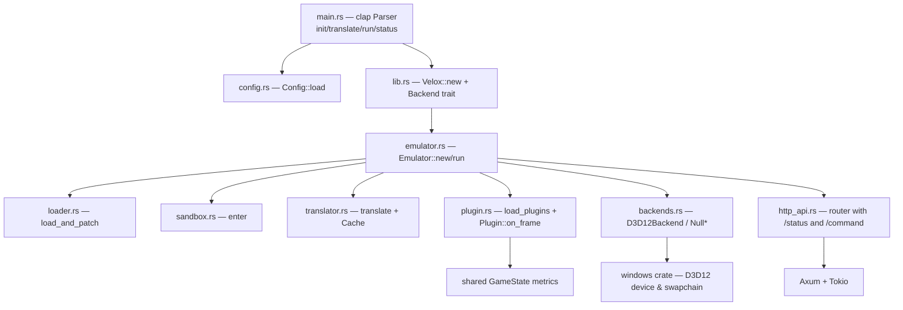

<!-- header:start -->
<div align="center">



<a href="#-quick-start"></a>

<a href="LICENSE"></a>

<a href="https://github.com/ajendras/velox/stargazers"></a>
<a href="https://github.com/ajendras/velox/actions/workflows/ci.yml"></a>

<a href="CONTRIBUTING.md"></a>

**Executes unaltered Xbox Series binaries on Windows via a modular native compatibility layer with pluggable backends and live HTTP monitoring**

[✨ Features](#-features) • [⚡ Quick start](#-quick-start) • [🧰 Usage](#-usage) • [🧩 Architecture](#-architecture) • [📍 Roadmap](#-roadmap) • [🤝 Contributing](#-contributing)

</div>
<!-- header:end -->

## ✨ Why Velox?

Latest-gen console exclusives stay locked behind proprietary hardware while official PC ports lag years behind. Existing emulation projects are monolithic, insecure, and lack extensibility for modders or researchers. Velox delivers a clean, testable, pluggable alternative that runs game code natively with strong sandbox defaults for preservationists, modders and high-end PC gamers.

- **Native execution** — Loads and runs unaltered Xbox Series PE binaries with `loader::load_and_patch` and entrypoint trampolines
- **Pluggable everything** — Swap GPU, audio and input providers at runtime via the `Backend`, `GpuBackend`, `AudioBackend` and `InputBackend` traits
- **Secure sandbox** — Memory isolation, page guards and strict API whitelisting are enabled by default with `sandbox::enter`
- **Live observability** — Real-time FPS, memory and command injection over HTTP using `http_api::router` and shared `GameState`

> 💡 Inspired by [Marvisak/VIctory](https://github.com/Marvisak/VIctory)

### How this differs
- True **native compatibility layer** instead of full CPU emulation, delivering higher performance and direct hardware access
- First-class **trait-based backends** and `Plugin` system let researchers and modders extend behaviour without patching binaries
- Built-in **Axum HTTP monitoring** (`/status` and `/command` endpoints) plus on-the-fly shader caching via `translator::Cache`
- Emphasis on testability — every module ships with unit tests and `tests/boot_test.rs` validates the full loader → sandbox → backend pipeline with mock titles

## 🎬 Demo

<p align="center"></p>

## 🚀 Features

<table>
<tr>
<td>
🎮 <b>Binary Loader</b><br>
Maps and launches original x86-64 executables plus DLLs inside a controlled process
</td>
<td>
🔄 <b>Shader Translator</b><br>
Converts console GPU bytecode to DXIL ahead-of-time or on-demand with disk cache
</td>
<td>
🔌 <b>Pluggable Backends</b><br>
Traits let users swap GPU (D3D12 default), audio, and input providers at runtime
</td>
</tr>
<tr>
<td>
🛡️ <b>Secure Sandbox</b><br>
Enforces memory isolation, API whitelisting and crash isolation by default
</td>
<td>
📡 <b>HTTP Monitoring</b><br>
Exposes live game state, FPS, memory stats and accepts remote commands via Axum
</td>
<td>
🧩 <b>Mod Plugins</b><br>
Dynamic library plugins hook into frame, input and shader events without patching binaries
</td>
</tr>
<tr>
<td>
📦 <b>Asset Streaming</b><br>
Parallel archive reader with on-the-fly BCPack/Zlib decode and texture detiling
</td>
<td>
🧪 <b>Comprehensive Tests</b><br>
Unit tests for translation correctness plus integration tests that boot mock titles
</td>
</tr>
</table>

## 📦 Installation

**Requirements**

- Rust 1.70 or newer
- Windows 10/11 (DirectX 12 capable GPU for the default D3D12 backend)

```bash
cargo install --git https://github.com/ajendras/velox
```

Or build from source:

```bash
git clone https://github.com/ajendras/velox.git
cd velox
cargo build --release
```

The resulting `velox` binary supports the four subcommands defined in `src/main.rs`.

## ⚡ Quick start

```rust
use std::path::Path;
use velox::{Config, Velox};

fn main() -> anyhow::Result<()> {
    let config = Config::default();
    let mut velox = Velox::new(config)?;
    velox.run(Path::new("game.exe"))?;
    Ok(())
}
```

Or via CLI (after `velox init`):

```bash
velox run game.exe
```

## 🧰 Usage

**CLI workflow**

```bash
velox init                     # creates velox.json with secure defaults
velox run game.exe             # full compatibility layer with sandbox + HTTP server
velox status                   # prints live metrics from the Axum endpoint
velox translate shader.bin     # ahead-of-time conversion with translator::Cache
```

**Library usage with custom config**

```rust
use velox::{Config, Velox};
use std::path::Path;

let mut cfg = Config::load("velox.json")?;
cfg.plugins = vec!["mods/fps_counter.dll".into()];
let mut velox = Velox::new(cfg)?;
velox.run(Path::new("game.exe"))?;
```

**Implementing a custom backend** (see `examples/custom_backend.rs`)

```rust
use velox::{Backend, DrawCommand};

struct LoggingBackend;

impl Backend for LoggingBackend {
    fn draw(&self, cmd: DrawCommand) {
        println!("[LOG] draw call: {} verts", cmd.vertex_count);
    }
    fn present(&self) {}
}

// Then pass via config.backend = "custom" (extended in your own crate)
```

<details><summary>Advanced: direct Emulator control + plugin testing</summary>

```rust
use velox::{Config, emulator::{Emulator, GameState}, plugin::test_plugins};

let cfg = Config::default();
let mut emu = Emulator::new(cfg)?;
let mut emu = /* ... */; // run() exercises loader::load_and_patch, translator::translate, sandbox::enter and http_api::router
```
</details>

## 🔧 Configuration

| Option      | Default             | Description |
|-------------|---------------------|-------------|
| `game_dir`  | `"."`               | Directory containing the game binary and assets (`Config::validate` checks existence) |
| `cache_dir` | `"./velox_cache"`   | Directory for shader cache, translated assets; `ensure_cache_dirs` creates `shaders/` subdir |
| `sandbox`   | `true`              | Enables memory isolation and API whitelisting via `sandbox::enter` |
| `backend`   | `"d3d12"`           | Name of backend; supported values: `"d3d12"`, `"null"` (used by `Emulator::new`) |
| `plugins`   | `[]`                | List of paths to dynamic libraries implementing the `Plugin` trait |

## 🧩 Architecture



The `Emulator` is the central orchestrator: it wires the PE loader, sandbox, shader translator, pluggable backends, mod plugins and background Axum server. `GameState` is shared via `Arc<Mutex>` so both the frame loop and HTTP handlers see live metrics. All heavy lifting lives behind clean traits, making the codebase easy to test and extend.

## 📁 Project structure

```text
.
├── Cargo.toml                  # bin "velox", lib, dependencies (clap, axum, windows, libloading, etc.)
├── src/
│   ├── lib.rs                  # Public API: Velox, Config, Backend trait, new()
│   ├── main.rs                 # CLI parser with subcommands init/translate/run/status
│   ├── config.rs               # Config struct + load(), validate(), ensure_cache_dirs()
│   ├── emulator.rs             # Emulator orchestrates run loop, GameState, HTTP server
│   ├── loader.rs               # load_and_patch(), LoadedBinary, patch_compatibility()
│   ├── translator.rs           # translate(), Cache with simple_hash and on-disk storage
│   ├── backends.rs             # Backend, GpuBackend, AudioBackend, InputBackend + D3D12Backend
│   ├── sandbox.rs              # enter(), page guards, API whitelist, VEH
│   ├── http_api.rs             # router(), status_handler, command_handler (inject_input etc.)
│   └── plugin.rs               # Plugin trait, load_plugins(), LoggerPlugin, DynamicPlugin
├── tests/
│   └── boot_test.rs            # Integration test exercising loader → sandbox → backend
└── examples/
    └── custom_backend.rs       # Demonstrates minimal GpuBackend implementation
```

## 🧪 Testing

```bash
cargo test
```

This runs all unit tests (backend creation, `D3D12Backend::new`, `loader` PE validation, `translator::Cache`, sandbox whitelist, `http_api` router construction, plugin hooks) plus the integration test in `tests/boot_test.rs` that boots a minimal mock executable and verifies the full pipeline.

## 📍 Roadmap
<!-- roadmap:start -->
- [x] **v0.1.0** — first release: Binary Loader, Shader Translator, Pluggable Backends, Secure Sandbox
- [ ] Add Vulkan backend implementing the GpuBackend trait
- [ ] Implement XMA/Opus audio decoding and playback backend
- [ ] Support trigger rumble and force-feedback in InputBackend
- [ ] Add game-specific patch database loaded by plugin system
- [ ] Expose GPU crash logs and live disassembly via HTTP API
- [ ] CLI command to upload/download community shader caches
- [ ] Integration test suite using real Series S asset samples
- [ ] Linux support using the same loader with DXVK translation
- [ ] Performance tracing UI served by the built-in HTTP server
- [ ] Metal backend for macOS via bytecode translation layer
- [ ] Benchmark suite comparing FPS against WARP software rasterizer
- [ ] Official plugin examples for common visual fixes (FSR, HDR)

> 🤖 This roadmap is worked through continuously — ideas and PRs welcome!
<!-- roadmap:end -->

## 🤝 Contributing

Contributions of any kind are welcome — from bug reports and documentation to new backends or plugin examples. Please read [CONTRIBUTING.md](CONTRIBUTING.md) and adhere to our [CODE_OF_CONDUCT.md](CODE_OF_CONDUCT.md). Good-first-issue PRs are especially appreciated for expanding test coverage, improving error messages in `config::validate`, or adding more example backends.

## 📄 License

Velox is licensed under either the MIT license or Apache License 2.0 (your choice). See [LICENSE](LICENSE) for details.

<!-- footer:start -->
<div align="center">

### ⭐ Star history

<a href="https://star-history.com/#ajendras/velox&Date"></a>

If **Velox** saves you time, a ⭐ helps others find it.

Made with ❤️ by [Ajendra](https://ajendra.info)


</div>
<!-- footer:end -->
